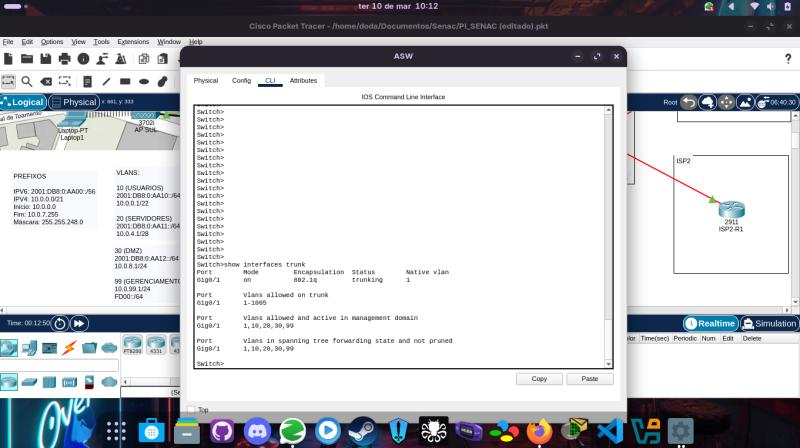
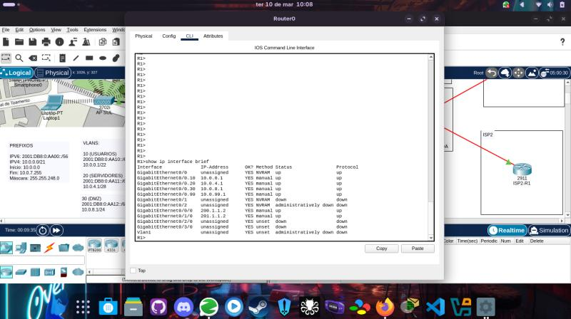
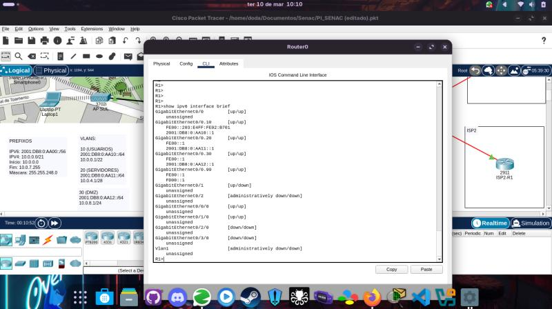
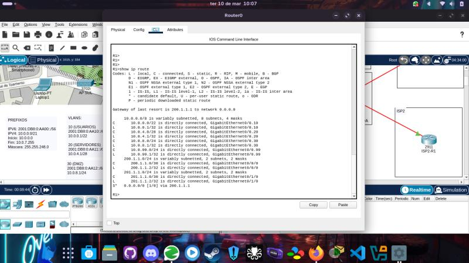
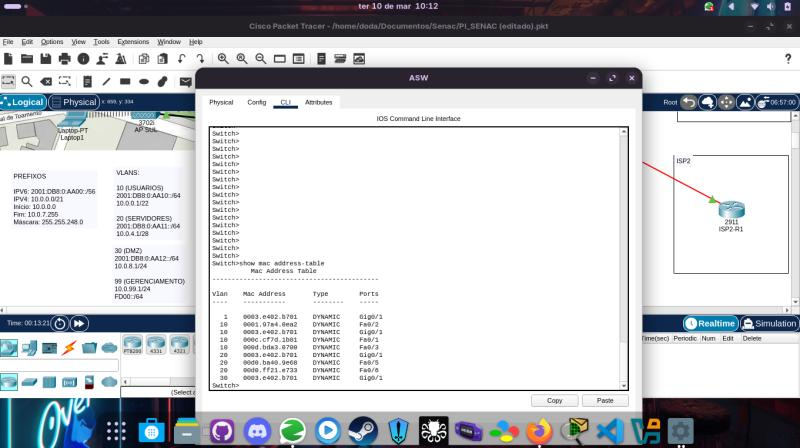
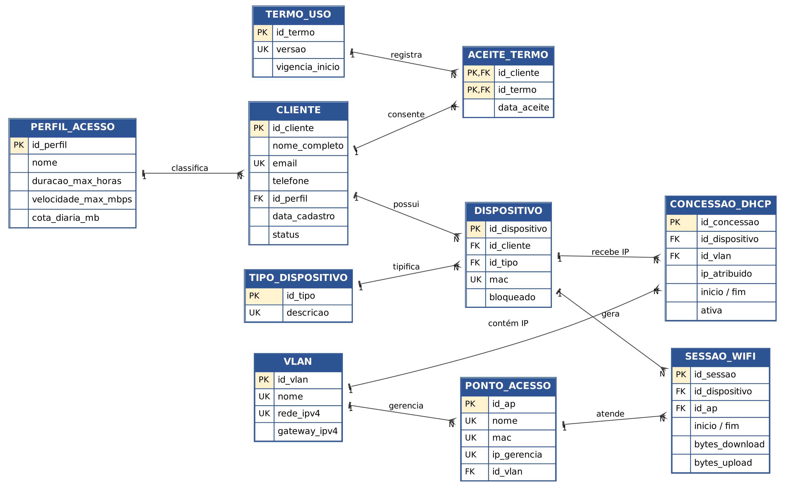
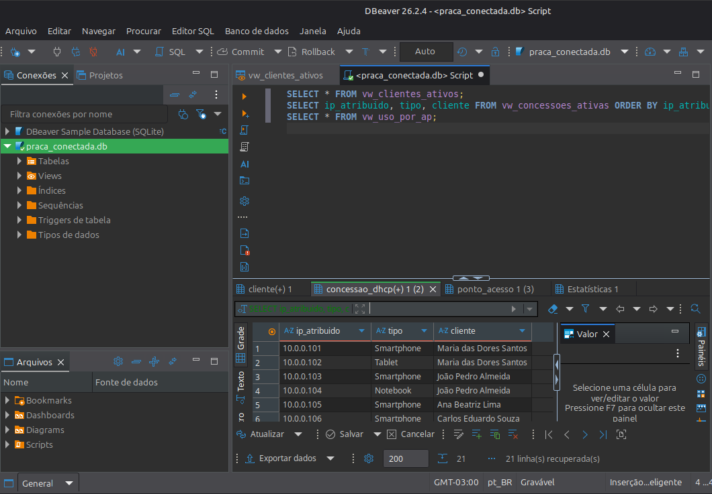
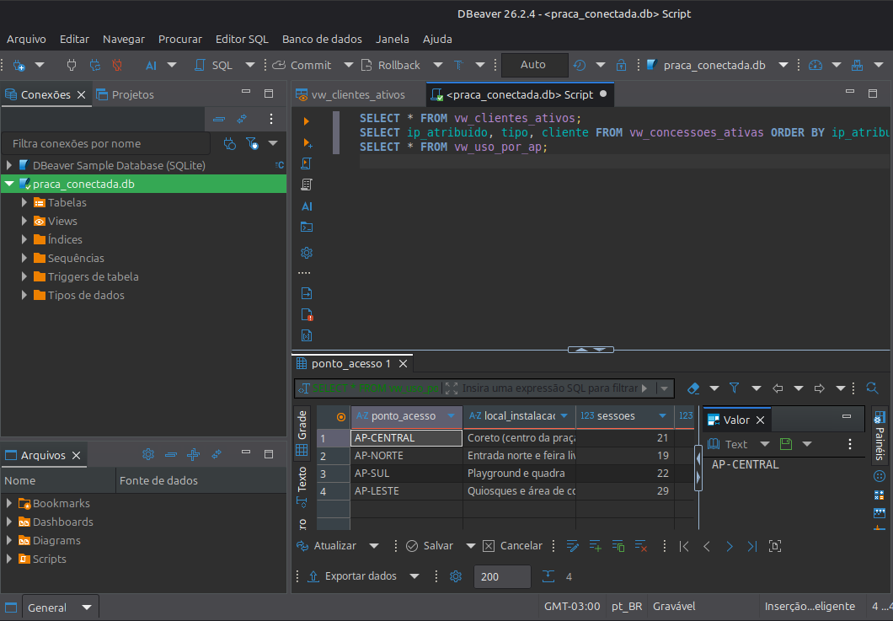
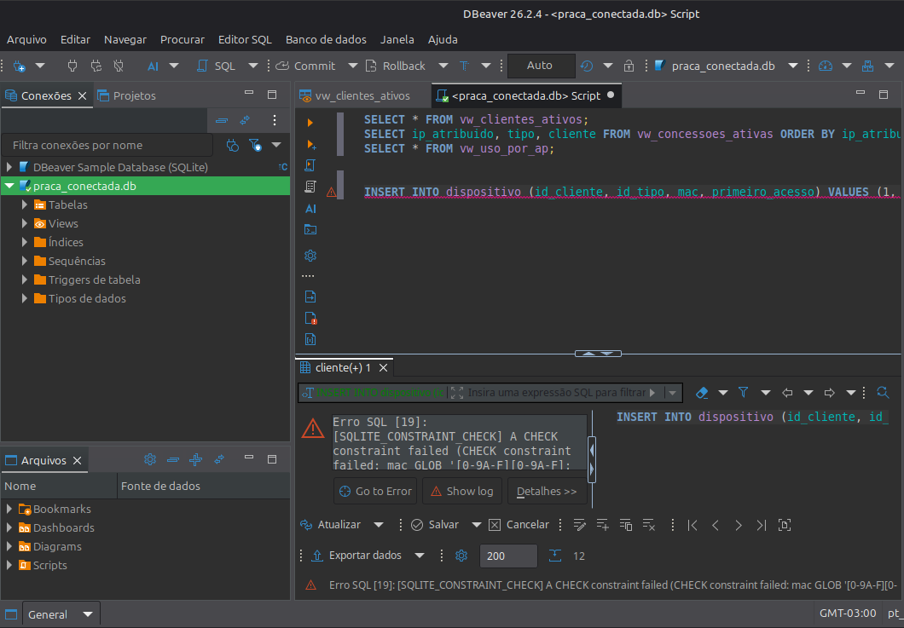
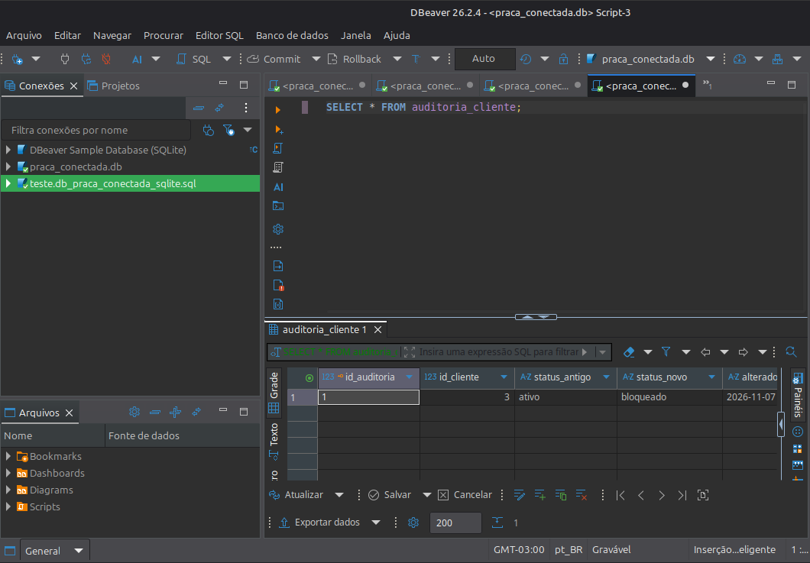

# 🌐 Projeto Integrador: Praça Conectada – Infraestrutura de Redes


Projeto Integrador do curso de **Tecnologia em Redes de Computadores (Senac EAD)**: uma rede local comunitária de alta disponibilidade, com VLANs, roteamento inter-VLAN, serviços de rede, redundância WAN, IPv6 e, na 2ª etapa, um **banco de dados de cadastro de clientes** integrado à rede.

## 📑 Sumário
- [Sobre o projeto](#-sobre-o-projeto)
- [Situação atual](#-situação-atual)
- [Topologia e configurações da rede](#️-topologia-e-configurações-da-rede)
- [Dual-Stack (IPv6)](#-dual-stack-ipv6)
- [Ativos de rede propostos](#-ativos-de-rede-propostos)
- [Segurança](#-segurança)
- [PI II: banco de dados de cadastro de clientes](#️-pi-ii-banco-de-dados-de-cadastro-de-clientes)
- [Evidências no DBeaver](#-evidências-no-dbeaver)
- [Cronograma](#-cronograma)
- [Estrutura do repositório](#-estrutura-do-repositório)
- [Próximos passos](#-próximos-passos)

## 📌 Sobre o projeto
A **Praça Conectada** simula um Wi-Fi comunitário para moradores, comerciantes e visitantes de uma praça pública. A topologia foi desenhada no **Cisco Packet Tracer** e contempla uma LAN conectada a **dois provedores de Internet (ISP1 e ISP2)**, com foco em escalabilidade, segurança e serviços essenciais.

**Equipe (grupo 06):** André Cervantes de Oliveira, Wilker Ferreira Coriolano, Deyvison Ferreira da Silva, Zayron Rodrigues Domingues e Armany Silva Peruzzo.

## ✅ Situação atual

| Item | Situação |
|---|---|
| Topologia no Packet Tracer (LAN + 2 ISPs) | ✅ Feito |
| VLANs 10/20/30/99 e trunk 802.1Q | ✅ Feito |
| Roteamento inter-VLAN (Router-on-a-Stick) | ✅ Feito |
| DHCP, DNS e servidor Web na DMZ | ✅ Feito |
| NAT Overload (PAT) | ✅ Feito |
| Endereçamento IPv6 (Dual-Stack) | ✅ Feito |
| Dimensionamento dos ativos e orçamento de referência | ✅ Feito (documento) |
| Modelo do banco de dados em 3FN, scripts SQLite e PostgreSQL | ✅ Feito e testado |
| Documento do PI II corrigido, com cronograma | ✅ Feito |
| Prints do banco de dados no DBeaver | 🔜 A adicionar |
| Política de segurança entre VLANs (ACLs) | 🔜 Proposta, ainda não implementada |
| Teste de failover entre ISP1 e ISP2 | 🔜 Próxima etapa |
| Carga automática das concessões DHCP no banco | 🔜 Evolução |

## 🛠️ Topologia e configurações da rede

### Visualização da topologia


Arquitetura: um **roteador central** (Router-on-a-Stick) e um **switch de acesso/core** ligados por trunk 802.1Q, com os dois ISPs na saída WAN.

### 1. Segmentação da rede (VLANs e inter-VLAN)
A rede foi segmentada em VLANs para organizar o tráfego e aumentar a segurança. A comunicação entre elas é feita por **Router-on-a-Stick** na interface `GigabitEthernet0/0` do roteador.

| VLAN | Nome | Rede IPv4 | Gateway | Finalidade |
|---|---|---|---|---|
| 10 | USERS | 10.0.0.0/22 | 10.0.0.1 | Smartphones e laptops da praça |
| 20 | SERVIDORES | 10.0.4.0/28 | 10.0.4.1 | DHCP e DNS (10.0.4.2) |
| 30 | DMZ | 10.0.8.0/24 | 10.0.8.1 | Servidor Web (10.0.8.2) |
| 99 | GERENCIAMENTO | 10.0.99.0/24* | 10.0.99.1 | Administração dos equipamentos |

\* Máscara da VLAN 99 adotada como proposta; as demais constam na topologia.

Estrutura de VLANs no switch ASW:


**Trunk:** a porta `Gig0/1` do switch é Trunk 802.1Q e transporta todas as VLANs até o roteador.

### 2. Endereçamento e roteamento (L3)
O roteador central gerencia as subinterfaces das VLANs e o roteamento para a WAN.

**Lado LAN (Router-on-a-Stick)**
- `Gi0/0.10` – 10.0.0.1 (gateway VLAN Usuários)
- `Gi0/0.20` – 10.0.4.1 (gateway VLAN Servidores)
- `Gi0/0.30` – 10.0.8.1 (gateway VLAN DMZ)
- `Gi0/0.99` – 10.0.99.1 (gateway VLAN Gerenciamento)

**Lado WAN (redundância)**
- `Gi0/1` – 200.1.1.2 (ISP1)
- `Gi0/1/0` – 201.1.1.2 (ISP2)

**Roteamento IPv4:** rota estática padrão `0.0.0.0/0` apontada para o gateway do ISP1 (200.1.1.1).

### 3. Serviços de rede (DHCP, DNS e Web)
Um servidor dedicado (**10.0.4.2**, VLAN de Servidores) provê os serviços essenciais:

- **DHCP:** distribui IPv4 dinamicamente aos dispositivos da VLAN de Usuários.
- **DNS:** servidor 10.0.4.2, com registro A de `www.praca.com.br` apontando para o servidor Web da DMZ (10.0.8.2).
- **Web:** servidor na DMZ, 10.0.8.2.

A imagem mostra a resolução DNS e o acesso à página Web do projeto a partir de um dispositivo da rede:


### 4. NAT (Network Address Translation)
Para que a rede interna (IPs privados 10.0.0.0/8) acesse a Internet, foi implementado **NAT Overload (PAT)**.

- **NAT Inside:** `Gi0/0.10`, `Gi0/0.20` e `Gi0/0.30`.
- **NAT Outside:** `Gi0/1` (ISP1) e `Gi0/1/0` (ISP2).

<details>
<summary>📎 Mais evidências do Packet Tracer (trunk, IPv4, IPv6, rotas e MAC)</summary>

| Trunk 802.1Q | Interfaces IPv4 |
|---|---|
|  |  |

| IPv6 | Tabela de rotas |
|---|---|
|  |  |

| Tabela MAC do switch |
|---|
|  |

</details>

## 🤝 Dual-Stack (IPv6)
A rede opera em **Dual-Stack**. O roteador central tem prefixos IPv6 globais e Link-Local (`FE80::`) em todas as subinterfaces das VLANs, deixando a infraestrutura preparada para o futuro da Internet. Um ponto alto do projeto foi o trabalho em equipe, com destaque para o colega **Daniel Lima**, responsável pela implementação completa do endereçamento IPv6 na primeira etapa.

Exemplo (VLAN Usuários):
- Interface: `Gi0/0.10`
- Endereço: `2001:DB8:0:AA10::1/64`
- Link-Local: `FE80::203:E4FF:FEB2:8701`

## 💻 Ativos de rede propostos
Equivalentes físicos Cisco e Dell para uma implantação real (valores de referência, sem cotação oficial; detalhes no Apêndice A do documento):

| Ativo | Modelo | Qtd. | Valor total de referência |
|---|---|---|---|
| Roteador/WAN (e representação dos ISPs) | Cisco Catalyst C8200-1N-4T | 3 | R$ 147.000,00 |
| Switch de acesso | Cisco Catalyst C9200L-24T-4G-A | 1 | R$ 10.301,56 |
| Access Points Wi-Fi 6 | Cisco Catalyst 9115AXI | 4 | R$ 23.992,12 |
| Servidores de serviços (DHCP, DNS, banco de dados) | Dell PowerEdge R260 | 2 | R$ 47.000,00 |
| Servidor Web (DMZ) | Dell PowerEdge R260 | 1 | R$ 23.500,00 |
| **Total estimado** | | | **R$ 251.793,68** |

## 🔒 Segurança
Já existe a base de segmentação (usuários, servidores, DMZ e gerenciamento). A política a seguir é **proposta** para a próxima implementação:

- VLAN 10 → VLAN 99: negar por padrão.
- VLAN 10 → VLAN 20: permitir apenas DHCP, DNS e serviços autorizados.
- VLAN 10 → VLAN 30: permitir somente os serviços Web publicados.
- Internet → VLAN 30: apenas HTTP/HTTPS; Internet → VLAN 20: negar.
- Administração dos equipamentos restrita à VLAN 99.

## 🗄️ PI II: banco de dados de cadastro de clientes
Para operar a rede como um serviço, o projeto ganhou um banco relacional que registra **quem usa a rede, com quais dispositivos, que IP recebeu do DHCP e em qual ponto de acesso houve conexão**, com registro de consentimento LGPD.

**Modelo em 3ª Forma Normal** – 10 tabelas de negócio e 1 de auditoria:

| Tabela | Papel |
|---|---|
| `vlan` | VLANs 10, 20, 30 e 99, com rede, gateway e pool DHCP |
| `perfil_acesso` | Visitante, Morador, Comerciante e Equipe TI (duração, velocidade e cota) |
| `cliente` | Cadastro do cliente (e-mail único, status ativo/bloqueado/inativo) |
| `termo_uso` e `aceite_termo` | Versões do termo e consentimento LGPD do cliente |
| `tipo_dispositivo` e `dispositivo` | Aparelhos do cliente, com MAC único |
| `concessao_dhcp` | Histórico de IPs entregues na VLAN 10 |
| `ponto_acesso` | Os 4 APs 9115AXI, com IP de gerência na VLAN 99 |
| `sessao_wifi` | Registros de conexão por AP, com bytes de download e upload |
| `auditoria_cliente` | Trilha de mudanças de status (gatilho) |



**Normalização aplicada:** a ficha inicial (uma planilha única) passou pela **1FN** (valores atômicos), **2FN** (sem dependências parciais) e **3FN** (sem dependências transitivas), eliminando redundâncias como limites de perfil e gateways repetidos.

**Regras de integridade no banco:** MAC único e válido; IP ativo único; uma concessão ativa por dispositivo; status restrito; gatilho que audita a mudança de status e bloqueia os dispositivos do cliente; e, no PostgreSQL, validação de que o IP pertence à rede da VLAN.

### ▶️ Como executar
**SQLite (sem instalar servidor)**
1. DBeaver > Banco de dados > Nova conexão > **SQLite**.
2. Em *Path*, escolha [`banco-de-dados/praca_conectada.db`](banco-de-dados/praca_conectada.db) e clique em *Testar conexão*.

**PostgreSQL**
1. Crie o banco `praca_conectada` e conecte no DBeaver.
2. Abra [`praca_conectada_postgres.sql`](banco-de-dados/praca_conectada_postgres.sql) e execute com **Alt+X**. As tabelas ficam no esquema `praca`.

Consultas de apresentação estão em [`banco-de-dados/consultas.sql`](banco-de-dados/consultas.sql).

### 📊 Exemplo de resultado
`SELECT * FROM vw_uso_por_ap;` (dados fictícios: 14 clientes, 22 dispositivos, 91 sessões)

| Ponto de acesso | Local | Sessões | Dispositivos | Download (MB) | Upload (MB) |
|---|---|---|---|---|---|
| AP-CENTRAL | Coreto (centro da praça) | 21 | 13 | 2.365,3 | 337,2 |
| AP-NORTE | Entrada norte e feira livre | 19 | 13 | 2.054,3 | 318,9 |
| AP-SUL | Playground e quadra | 22 | 15 | 2.958,8 | 402,0 |
| AP-LESTE | Quiosques e área de convivência | 29 | 18 | 3.459,8 | 432,6 |

> Todos os dados de exemplo são **fictícios** (e-mails do domínio `exemplo.com.br` e MACs de administração local). O cadastro segue a minimização da LGPD: apenas nome, e-mail e telefone.

## 📸 Evidências no DBeaver
Os prints do banco de dados rodando no DBeaver serão adicionados aqui. Cada imagem deve ser salva em [`banco-de-dados/imagens/`](banco-de-dados/imagens/) com o nome sugerido (veja o [guia de prints](banco-de-dados/imagens/LEIA-ME.md)).

| # | Evidência | Arquivo sugerido | Situação |
|---|---|---|---|
| 1 | Conexão criada e tabelas listadas | `01-conexao-tabelas.png` | 🔜 |
| 2 | Diagrama ER gerado pelo DBeaver | `02-diagrama-dbeaver.png` | 🔜 |
| 3 | Tabela `cliente` com os dados | `03-tabela-cliente.png` | 🔜 |
| 4 | Concessões DHCP ativas (`vw_concessoes_ativas`) | `04-concessoes-ativas.png` | 🔜 |
| 5 | Uso por ponto de acesso (`vw_uso_por_ap`) | `05-uso-por-ap.png` | 🔜 |
| 6 | Teste de regra recusada (MAC inválido) | `06-teste-integridade.png` | 🔜 |
| 7 | Bloqueio de cliente e tabela de auditoria | `07-auditoria.png` | 🔜 |

<!-- Quando os prints estiverem na pasta, descomente as linhas abaixo:






-->

## 📅 Cronograma
16 semanas, de 17/08 a 04/12/2026 (datas previstas, ajustáveis ao calendário da disciplina).

| Fase | Semanas | Entrega |
|---|---|---|
| 1. Planejamento e levantamento | S1–S2 | Base técnica e plano do projeto |
| 2. Projeto lógico da rede | S3–S5 | Topologia, VLANs e endereçamento (1ª entrega) |
| 3. Implementação da rede | S6–S10 | Router-on-a-Stick, DHCP/DNS/Web, NAT/PAT e testes |
| 4. Banco de dados de clientes | S11–S13 | DER, normalização 3FN, scripts SQL e testes no DBeaver |
| 5. Segurança e documentação | S13–S15 | ACLs, LGPD, análise e publicação no GitHub |
| 6. Revisão e entrega | S15–S16 | Versão final do PI II |

O detalhamento (atividades, responsáveis, marcos, ordem de implementação e riscos) está no capítulo 5 do documento em [`documentacao/`](documentacao/).

## 📂 Estrutura do repositório
```
.
├── README.md
├── documentacao/
│   ├── Projeto_Integrador_II_Corrigido.docx
│   └── Projeto_Integrador_II_Corrigido.pdf
├── banco-de-dados/
│   ├── praca_conectada.db              # SQLite pronto para o DBeaver
│   ├── praca_conectada_sqlite.sql
│   ├── praca_conectada_postgres.sql
│   ├── consultas.sql
│   ├── diagrama_er.png
│   └── imagens/                        # prints do DBeaver
└── *.jpg                               # evidências do Packet Tracer
```

## 🚀 Próximos passos
- [ ] Adicionar os prints do DBeaver (seção acima).
- [ ] Implementar as ACLs entre as VLANs e restringir a administração à VLAN 99.
- [ ] Testar o failover entre ISP1 e ISP2.
- [ ] Automatizar a carga das concessões DHCP e das sessões no banco.
- [ ] Definir o prazo de guarda dos registros de conexão (Marco Civil da Internet) e a rotina de backup do banco.

## 📚 Documentação
- 📄 [Projeto Integrador II (PDF)](documentacao/Projeto_Integrador_II_Corrigido.pdf) · [Word](documentacao/Projeto_Integrador_II_Corrigido.docx)
- 🗄️ [Banco de dados](banco-de-dados/README.md)
