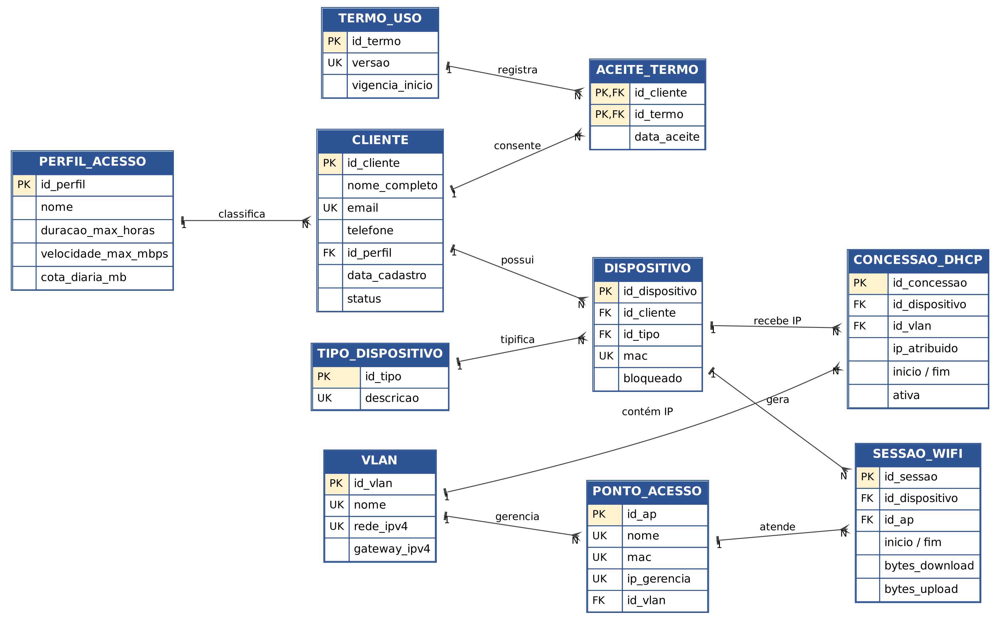

# Banco de dados – cadastro de clientes da Praça Conectada

Modelo relacional em **3FN** para cadastrar novos clientes da rede Wi-Fi comunitária, seus dispositivos, os IPs concedidos pelo DHCP (VLAN 10) e as sessões por ponto de acesso. Todos os dados de exemplo são **fictícios**.

| Arquivo | Conteúdo |
|---|---|
| `praca_conectada.db` | Banco SQLite pronto (abrir direto no DBeaver) |
| `praca_conectada_sqlite.sql` | Script completo SQLite (tabelas, restrições, gatilhos, dados e visões) |
| `praca_conectada_postgres.sql` | Script completo PostgreSQL 16 (cria o esquema `praca`) |
| `consultas.sql` | Consultas de apresentação e testes de integridade |
| `diagrama_er.png` | Diagrama entidade-relacionamento |

## Abrir no DBeaver
**SQLite:** Banco de dados > Nova conexão > SQLite > *Path* = `praca_conectada.db` > Testar conexão.
**PostgreSQL:** crie o banco `praca_conectada`, conecte-se, abra `praca_conectada_postgres.sql` e execute com **Alt+X**. As tabelas ficam no esquema `praca`.

## Modelo (10 tabelas + auditoria)
`vlan`, `perfil_acesso`, `tipo_dispositivo`, `termo_uso`, `ponto_acesso`, `cliente`, `aceite_termo`, `dispositivo`, `concessao_dhcp`, `sessao_wifi`, `auditoria_cliente`.

Regras: MAC único e válido; IP ativo único; uma concessão ativa por dispositivo; status restrito; gatilho de auditoria e bloqueio de dispositivos; no PostgreSQL, o IP deve pertencer à rede da VLAN.

